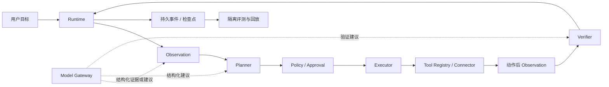

# Phone-first General Agent Platform
## 项目首席架构师与验收执行方案（修订版）

版本：2026-10-13 / v2
文档性质：产品、架构、实施、验收和回滚方案；不是代码、真机或商业化完成证明。
适用仓库：`https://github.com/q2904047615-jpg/phone-visual-agent`
执行工作树、分支和基线：**尚未冻结，必须由阶段 0 实地核对后填写。**
原稿声明：工作树 `D:/AIData/Codex/Home/worktrees/bb68/手机自动点击器`，文档基线 `7901290`；保留为来源记录，不视为本次已核实的执行环境。
已有阅读报告基线：`d3f239548558f04b8da0820678aa5851de175844`；它是此前静态审查快照，不代表此刻远端 HEAD 或本机加载版本。

## 0. 使用方式、证据和执行边界

本文件回答：建设什么、先做什么、如何证明有效、失败如何恢复、何时值得继续投入。

执行前读取本文件以及实际工作树中的 `项目最终目标.md`、`项目交接文档.md`、`用户决策与协议边界.md`。先定位文件，不猜测路径或内容。文档冲突以用户最新明确决定为准；无法确认的冲突记入决策表，只阻断受影响的能力，不阻断只读开发和离线验证。

本轮用户授权是修改方案，不包括修改代码、运行手机、调用付费模型、重启服务、提交或发布。未来执行者必须依据当时的任务授权行动；文档中的实施步骤不自动授予外部操作权限。

### 0.1 证据标签

- **已验证可行**：明确写出验证对象、源码版本、测试/运行时间、环境、证据路径和范围。
- **有条件可行**：写明前提、缺失证据和关闭条件。
- **尚未验证**：设计、静态推断、Mock 或历史运行不足以支持当前目标结论。
- **不建议**：会引入冲突权威、越权、绕过官方入口或无法控制不确定外部效果。

分别报告：代码存在、测试通过、服务加载、手机动作派发、业务目标完成、客户付费。前一项不能代替后一项。建议、假设、用户决定和观测事实必须分开。

### 0.2 修订依据

1. 用户提供的原稿：`D:/Backup/Documents/xwechat_files/wxid_lgrcrozqbqft22_86cf/temp/RWTemp/2026-10/9e20f478899dc29eb19741386f9343c8/项目首席架构师与验收执行提示词.md`，原版本 2026-10-12。
2. 本地静态阅读报告：`D:/ai学习/work/phone-visual-agent-review-20261013/phone-visual-agent-full-read-report.md`，对应上述 `d3f2395...` 快照。报告中的代码判断不是本轮重新运行测试的结果。
3. 工作台规则：`D:/ai学习/personal-ai-workbench/05_rules/context.md`。记录了产品变现目标、预算 1000 以内及付款、发布、登录、删除前暂停的规则；预算币种、统计周期和剩余额度尚未确认。

本轮只修订方案，没有验证原稿工作树上的新增实现、真实设备、服务或最新 GitHub 状态。

## 1. 产品范围与首发目标

长期产品是以手机为第一执行连接器的通用 Agent 平台。自然语言目标进入平台后，由平台完成任务建模、计划、授权、工具执行、观察、验证、恢复、审计和结果交付。

首发技术范围收敛为：**单用户、单设备、一个真实模型 provider、可恢复 Runtime、只读导航任务、可追溯结果**。三 App 验收用于证明这一区间的适用性，不代表任意 App、任意任务或可商业规模化。

本次首发验收范围暂不覆盖：多租户、分布式设备池、真实多模型路由、长期用户记忆、自动发送/发布/删除、自动交易和平台化计费。这里是验收范围控制，不改变现行产品风险边界：普通发送、发布、删除等仍按已批准协议默认自动执行；后续开放这些场景前，另行冻结样本、确认和业务结果合同。

### 1.1 商业验证从阶段 0 开始

在扩建平台前建立一页“首个付费场景假设”，填写目标客户、实际任务、频次、现有人工流程、交付物、客户可核对的成功条件、可接受的失败影响、兼容环境和预计成本。客户尚不明确时标为假设，不自行虚构订单或需求。

先用已有需求和用户反馈验证场景；联系客户、报价、收款或公开承诺需有对应授权。三 App 只读任务是技术测试，不自动等同于付费场景。若首个真实需求需要写操作，必须先关闭第 11 节对应的权限决策。

### 1.2 网站产品形态与首屏承诺

本项目需要一个 Agent 控制台网站，作为 Control Plane 的用户界面和客户入口；它不是第二套 Runtime、不是 Qwen 操作面板，也不是只展示截图的网页。网站通过类型化 API 读取和提交 Task/Run/Step、设备、计划、策略、确认、事件和证据，不能在浏览器端重新规划、绕过 Policy、直接调用手机或让模型拥有终态权威。

客户打开首页后必须立即理解三件事：

> **用一句话告诉 Agent 你想让手机做什么，实时看到它如何执行，并拿到可核对的结果。**

首屏只保留一个主要入口：自然语言任务输入框；旁边显示当前设备/连接器、可用状态和“开始任务”动作。首屏同时用三步说明产品：描述目标 → Agent 逐步执行并验证 → 查看结果与证据。不要先展示模型名称、内部模块、坐标或复杂配置。用一个导航只读示例和一张真实运行时间线说明能力，示例必须标为示例，不伪造成功案例或客户付款。

网站功能按以下信息架构设计：

| 区域 | 客户能做什么 | 首发状态 |
|---|---|---|
| 首页/介绍 | 理解产品做什么、适用范围、三步工作方式、连接器和证据特点 | 阶段 0 定义，阶段 3 可对外展示 |
| 新建任务 | 输入自然语言目标，选择设备/连接器，查看预算和预计权限，提交或保存草稿 | 阶段 1 接入 Runtime |
| 任务列表 | 按状态、时间、设备、失败分类筛选；进入某次 Run | 阶段 1 |
| 运行详情 | 看当前状态、计划步骤、当前观察、动作回执、Verifier 结论、剩余预算、暂停/恢复/取消 | 阶段 1 |
| Session/Trace | 按 Session、Run/Turn、Step 展开模型建议、Policy、工具、观察、验证、耗时和错误摘要 | 阶段 1/3 |
| 确认中心 | 仅展示平台 Policy 返回的认证/付款确认；显示确认对象、范围、有效期和撤销状态 | 阶段 1/3 |
| 设备与连接器 | 查看设备在线、相机/控制器、租约、能力、连接器版本和故障原因 | 阶段 1/2 |
| 证据与回放 | 查看截图、事件时间线、模型/工具调用引用、失败分类和只读回放 | 阶段 4 |
| 用量与设置 | 查看调用量、成本估算、数据保留、通知、个人配置和帮助反馈 | 阶段 4/6 |
| 团队与管理 | 用户、角色、项目、配额、审计、设备归属和 API/SDK 凭据 | 阶段 5/6 |

网站交互规则：

1. 所有状态来自 Runtime 查询，浏览器刷新、断线和重复提交必须安全；提交使用幂等键，不能因刷新重复创建任务。
2. 运行页把“已创建、规划中、等待确认、执行中、观察中、恢复中、暂停、失败、成功、取消、未知”显示为明确状态，并同时显示下一步和阻断原因。
3. 网站显示工具执行成功与业务目标完成的区别；finish、截图或模型文字不能单独把页面标成成功。
4. 确认弹窗只由 Policy 的结构化结果驱动，网站不凭按钮文案自行添加或取消确认；普通操作仍遵循当前已批准协议。
5. 设备离线、租约失效、观察失败和外部效果未知时，页面必须显示可行动的技术原因、是否停止派发、是否允许恢复，以及证据引用。
6. 桌面和窄屏均可用，主任务入口、运行状态和错误信息不藏在多级菜单；颜色、文字和图标同时表达状态，避免只靠颜色。
7. 所有客户可见文案使用“目标、执行、验证、结果、证据”等产品语言；内部的 Planner、Policy、Verifier 等术语在详情页解释，不作为首页门槛。

8. 运行详情支持实时事件更新和断线续看；用户能从失败步骤直接看到主分类、外部效果状态、可执行的恢复动作和对应证据，不需要回到多个页面拼接原因。

网站不承诺任意 App、任意任务、连续无人值守或确定的商业成功。首发页面必须明确当前支持范围、连接器状态和“尚未验证”的能力，不能把离线测试、Mock、历史截图或模型建议写成真实手机完成。

### 1.3 公开 Agent 产品对标与采用原则

本方案参考公开官方资料，只采用可核对的产品结构，不推测各家的私有前端框架、数据库或未公开实现：

| 公开参考 | 官方资料中可核对的模式 | 本项目采用方式 |
|---|---|---|
| [OpenAI Agents](https://developers.openai.com/api/docs/guides/agents) / [Tracing](https://developers.openai.com/api/docs/guides/agents-api/tracing) | Agent、Session、Turn、Event、Model/Tool span 分层；运行过程可展开查看 | 网站使用 Session → Run/Turn → Step/Trace 的层级，客户能看到进度、工具、结果和耗时 |
| [Anthropic Computer Use](https://platform.claude.com/docs/en/agents-and-tools/tool-use/computer-use-tool) | 模型提出 screenshot、click、type 等工具调用，应用方控制实际执行环境 | 手机连接器和执行许可由 Runtime/Executor 控制，模型只能提供结构化建议 |
| [Dify 日志](https://github.com/langgenius/dify-docs/blob/main/en/cloud/use-dify/monitor/logs.mdx) | 对话日志与工作流运行日志分开，支持检查和下载 | 网站分开显示用户任务、运行 Trace、证据附件和导出审计 |
| [Manus Agents](https://open.manus.ai/docs/v2/agents-overview) | 用户以任务和持久 Agent 会话为主要入口，不要求先配置内部工作流 | 首屏只突出自然语言目标、设备和结果；高级工具/模型配置后置 |

由此确定五条网站原则：

1. **首屏先说明价值**：客户先看到“描述目标、Agent 执行、验证结果”，模型、Prompt、坐标和连接器实现放到详情或设置。
2. **过程可见但不泄漏内部推理**：展示计划步骤、工具调用摘要、策略结果、观察、Verifier 结论、耗时和错误；不把隐藏思考内容当作产品功能或审计依据。
3. **状态以 Session/Run/Turn/Step 为骨架**：一条任务可以有多轮交互、暂停恢复和重新规划；刷新、重连和继续操作都回到同一服务端状态。
4. **实时更新来自服务端**：优先使用服务端事件流；无法使用时使用带版本/游标的轮询。前端不依据局部消息自行推断成功、失败或动作已停止。
5. **简单入口与专业详情并存**：普通客户只走“输入目标 → 查看运行 → 查看结果”；调试和管理员可展开 Trace、连接器、策略和证据，不把复杂工作流编辑器作为首发入口。

上述对标只证明这些交互和运行记录模式已经被公开产品采用，不证明本项目已经具备对应能力；本项目仍须通过 W0–W6 和真实只读 Run 验收。

## 2. 唯一权威和模块职责

| 模块 | 唯一职责 | 不得承担的职责 |
|---|---|---|
| Runtime | 生命周期、计划版本提交、预算、设备租约、执行许可、状态转换和终态写入 | 不凭模型 `finish` 或工具成功直接宣告业务成功 |
| Planner | 计划、依赖、显式成功/失败条件和下一步 ToolIntent 提案 | 不派发动作、不消费 scope、不自签执行许可 |
| Policy/Approval | 校验任务权限、效果类别和确认范围，输出 allow/confirm/deny/handoff | 不把模型声称的低风险直接当成授权 |
| Executor | 校验许可后执行一个注册工具动作 | 不重新规划、不替换获批动作、不判任务完成 |
| Verifier | 根据显式合同评定工具、步骤和业务结果，输出证据结论 | 不写 Runtime 终态、不隐藏增加成功条件、不发动作 |
| Model Gateway | 模型能力、请求、配额预留、超时、用量、费用和失败记录 | 不掌握任务或物理动作权威 |
| Tool Registry | 工具 schema、能力、权限、幂等和补偿描述 | 不按 App 名或关键词暗中选择业务脚本 |
| Event Store / Evaluation | 持久证据、查询、离线回放和固定版本评分 | 不为通过评测修改生产策略或派发真实动作 |

Qwen 是默认候选视觉/语义 provider。模型可提出观察、目标候选、计划和验证建议，但模型响应不构成执行许可或任务终态。即便 Planner 和 Verifier 使用同一模型，也须通过独立合同校验；角色拆分本身不证明判断独立或正确。

## 3. 基线差异与当前状态

当前统一结论：**迁移状态需要按具体工作树复核，不是 Beta/GA，也没有完整商业化证据。**

本方案的阶段编号是本修订版内部编号。历史台账中曾把 Planner/Policy/Verifier 代码迁移称为“阶段 3”，不能与本方案的“阶段 3：平台权威迁移和跨 App 验收”直接等同；代码批次、离线门、服务加载门和三 App 真机门必须分别记录。

| 对象 | 原稿声明 | 已有静态报告支持的事实 | 待核对内容 |
|---|---|---|---|
| 基线 | `7901290`、bb68 工作树 | 报告读取 `d3f2395...` 快照 | 两提交是否同仓、祖先关系、未提交差异、实际加载版本 |
| Runtime | 实体和连接器合同已有代码 | 报告描述进程内会话和 JSON 证据 | 原稿分支是否新增 SQLite、租约和恢复闭环 |
| Gateway/Registry | 兼容层已有代码 | 报告描述以 Qwen 为主的调用和用量证据 | 所有生产入口是否统一，预算是否真实强制执行 |
| Planner/Verifier | 接口及部分门禁已有代码 | 报告描述 Qwen 响应直接 action/finish | 新接口是否进入实际调用链，旧权威是否仍有效 |
| 输入验证 | 要求动作后验证 | 报告发现输入确认文案与底层证据可能不一致 | 证据不足时是否正确显示 uncertain，而非“确认成功” |
| 真机/商业 | 尚未闭环 | 离线 CI 证据不能证明真机或付费结果 | 当前真实记录、失败、成本、客户需求 |

不得把原稿“已有代码”抄成核实事实，也不得把旧快照的缺口直接判定为新工作树仍缺失。阶段 0 使用“要求—当前实现—证据—差距—下一步”五列表消除差异。

## 4. 阶段 0：冻结基线、合同与首发范围

### 实施步骤

1. 只读确认仓库根目录、remote、分支、完整 HEAD、dirty 状态和目标工作树；核对 `7901290` 与审查快照关系。目录或提交不存在则记录，不伪造基线，不直接在另一个目录执行。
2. 分别登记源码基线、测试基线、构建/服务加载基线；没有加载证据时填写“未验证”。配置只记录非敏感标识和哈希，不输出密钥。
3. 建立第 3 节五列表，覆盖生命周期、Qwen action/finish、Planner、Policy、Executor、Verifier、Gateway、Registry、Memory、Event Store、网页入口及专项入口。
4. 核对四份权威文档，记录冲突、来源、已有用户决定、临时只读限制和关闭条件。文档同步列为后续执行项，本方案更新不代表其他文档已更新。
5. 冻结首发能力、结果合同、错误模型、风险边界、只读样本和验收预算；用第 1.1 节模板登记商业场景假设。
6. 记录回滚点：源码、配置、服务标识、数据库 schema 版本、数据备份与设备租约。只读核对卖家进程，不操作卖家 `main.exe`。

### 交付物与退出门

交付基线清单、五列表、决策记录、版本化合同草案、样本清单及回滚清单。唯一执行树和权限边界可辨认，相关文档没有未标记冲突，才关闭阶段 0。缺少密钥、设备或付费授权不阻断离线设计，但必须阻断依赖它们的实机步骤。

## 5. 核心接口合同（先冻结，再实现）

以下为目标设计，不是现有类型已经实现的声明。对象使用版本化 schema，必填字段按对象类型定义；聊天或离线分析等无设备请求不得伪造 device_id。进入手机执行链的对象必须携带完整执行绑定。

| 对象 | 必要内容与约束 |
|---|---|
| Plan | task/run、plan_id/version、目标、受支持范围、步骤依赖、可观测成功/失败条件、预算、策略版本；未来步骤不含可复用坐标 |
| ObservationFacts | device、observation_id、采集时间、有效期、fingerprint、帧引用/哈希、坐标系与变换版本、候选 element_id/bounds、可见证据及 unknown 项；element_id 只在当前观察有效 |
| ToolIntent | task/run/step、plan_version、工具名/版本、动作类型、当前观察目标引用、参数摘要、前置条件、预期后置条件、效果声明；不含自行生效的执行权限 |
| PolicyDecision | intent_digest、policy_version、allow/confirm/deny/handoff、可核对的依据、批准范围、有效期、审批标识；确认绑定当前意图和效果 |
| ExecutionPermit | Runtime 签发或服务端保存的一次性许可；绑定 task/run/step/device/lease_epoch/plan_version/observation_id/fingerprint/tool_version/intent_digest/policy_decision/expiry/nonce |
| ToolCall/Result | call_id、幂等键、许可引用、派发阶段、transport 回执、时间、效果 known/unknown 和错误；回执成功不代表业务成功 |
| VerificationResult | before/after 引用、call_id、plan_version、逐项证据、transport_result、visual_result、step_result、business_result、unknown 原因和建议下一状态 |

### 5.1 几何、许可和过期规则

Planner 引用当前观察中的目标候选或受限导航动作；模型给出的几何只是候选。平台依据当前帧尺寸、裁剪/旋转/校准版本验证目标并生成最终 canonical payload，将最终参数摘要绑定许可。无元素引用的 Home/Back 等动作也必须在允许动作集合内。

许可由 Runtime 的可信代码边界签发，模型和 Planner 插件无签发能力。单进程可用服务端不可伪造句柄；跨进程时使用可验证签名或等效认证机制。具体实现选择要记录，不将“有一个 signature 字段”当成安全证明。

观察、计划、参数、设备租约或策略发生变化时许可失效。Executor 不得改参数后沿用旧批准。若重观察使已确认对象变化，重新核对现有授权是否覆盖；不自动沿用过期 scope，也不无理由重复询问已明确覆盖的授权。

### 5.2 完成与未知规则

Verifier 依据创建计划时声明的验收条件逐项评定，不能把页面变化、键盘收起、transport ACK 或模型自信当成成功。输入值不可见且无可信回读时标记 unknown，不写“已确认输入值”。

导航任务要求目标页面证据；发送任务需可靠送达/提交证据；仅视觉无法确认的后台效果必须保留未知或请求人工核验。首发不开放发送任务，此条仅约束未来扩展。

Runtime 只有在必要条件均 matched、没有未决效果、没有未处理阻断并通过状态机校验时才能写 succeeded。Verifier 可以使用模型辅助，但最终结构和证据检查由平台代码执行。无法设计可观测验收条件的任务不进入首发承诺范围。

## 6. 阶段 1：Runtime 持久化最小闭环

### 实施顺序

1. 实现 Task/Run/Step、Observation、ToolCall/Result、Verification、Approval、Failure 和 Event 最小实体；先单用户单设备 SQLite，不提前引入分布式组件。
2. 为状态转换与事件追加建立同一数据库事务，使用单调事件序号、状态版本校验和唯一约束防止重复转换。
3. 建立带 owner、有效期和 fencing epoch 的设备租约；派发前确认租约，租约失效即停止新动作。终态或恢复前先处理仍在执行/状态不明的工具调用，不能提前释放后让另一个任务重叠控制。
4. 明确 `prepared → dispatching → acknowledged/unknown` 派发阶段。派发前原子保存 ToolCall、参数和许可消费记录；标记 dispatching 后才允许外部调用。
5. 数据库提交与硬件效果无法跨系统原子化。进程在 dispatching 之后崩溃时，按“可能已执行”恢复，不声称 exactly-once，不自动重发。只有连接器能提供可信幂等查询/回执时才据此消除不确定性。
6. 动作后采集新观察，持久化验证结果。恢复使旧许可、坐标和决策失效；遇到未决副作用先只读核对或人工处理，不让 Planner 换一个 call_id 重复同一效果。
7. 暂停/取消阻止新派发；已发动作可能无法撤回，等待结果或记 unknown。明确 UI 显示“取消请求”与“已停止派发”的区别。
8. 提供类型化查询、暂停、恢复、取消接口；调用前核对当前 OpenAPI。

9. 为网站提供稳定的只读查询模型和幂等命令接口：任务列表/详情、当前 Run、步骤时间线、最新 Observation、Verification、Failure、Approval、设备状态和证据引用。接口必须带 task_id/run_id/step_id 及版本或游标，断线重连能继续读取，不让前端拼接多个响应猜测终态。
10. 为运行详情页定义最小状态投影和权限过滤；敏感图片、日志和凭据引用按当前用户/任务授权返回，前端不能通过修改查询参数扩大范围。

11. 将 Session、Run/Turn、Step、TraceEvent 建立稳定关联；每个事件至少有发生时间、状态、来源、输入/输出引用、耗时、错误分类和版本。前端可以按事件游标增量更新，不能把模型文本、工具回执或浏览器日志单独当作终态。

### 验证与退出门

离线覆盖：状态正反例、SQLite 重启、事件顺序、并发抢租约、过期许可、暂停/取消、各派发边界崩溃、观察失败、重复请求和未知效果禁止重放。

另设真实连接器验收：一个已授权只读动作，保存前后观察、调用、回执、验证和租约。可通过受限连接器验收入口执行，不经旧 Qwen 动作权威；该入口不对产品任务开放。设备条件不具备时标“离线门通过、真机门未通过”，可继续离线开发，不得称阶段已完成。

数据回滚与代码回滚分开设计：采用可兼容的 schema 迁移或独立版本化数据库，禁止旧服务打开不兼容 schema。保留证据，不恢复旧可用 scope。

## 7. 阶段 2：最小 Model Gateway 和 Tool Registry

1. 所有模型入口包括聊天分类、观察、Planner、Verifier 都经过 Gateway；登记 provider、能力、版本、结构化 schema、图片限制、超时、重试和可用状态。
2. 第一版用一个真实 Qwen provider 加替代 Stub 验证解耦；第二真实 provider 后置。该项是实施默认建议，不冒充用户已批准新的调用或费用。
3. 每次调用持久化 request_id、run/step/观察引用（适用时）、模型版本、时延、用量和错误。费用区分估算、provider 实际用量和账单核对，价格来源和时间可追溯。
4. 预算预留在调用前生效；返回后结算，超时/未知计费保留待核对额，不能当零费用。任务设调用、动作、时间和金额上限；额度不足暂停，不仅显示一个统计数字。
5. ToolRegistration 声明 schema、效果类别、权限、幂等语义、模拟/真实支持、健康证据及时间、失败类型。补偿显式写 `none` 或具体补偿合同；发送/发布等不得宣称通用可回滚。
6. Executor 只调用注册工具。禁止业务代码直接构造 provider 和绕过 Registry；新增模型不要求修改 Runtime 生命周期。

验证包括未知模型/工具、能力不匹配、结构化失败、超时、并发预算预留、调用重试和成本记账。模型请求重试不会自动触发物理重试。真实模型证据与 Stub 证据分别报告。

网站在本阶段接入模型和工具注册表的展示层：展示当前 provider、模型/工具能力、版本、延迟和健康证据，但不把 provider 名称作为客户必须理解的概念，也不允许浏览器选择未注册工具、改写 schema 或绕过预算和策略。模型调用失败在运行页归类为模型/合同/网络等实际主分类，不能笼统显示“Agent 出错”。

## 8. 阶段 3：新链验证、生产切换和跨 App 验收

### 8.1 先建设，后切换

迁移分四步，禁止先删除旧入口再寻找替代实现：

1. **新链离线闭环**：Runtime → ObservationFacts → Planner/ToolIntent → Policy → Permit → Mock Executor → after Observation → Verifier → Runtime。所有状态只有一个 Runtime 写入者。
2. **历史回放/影子验证**：使用复制且隔离的历史证据；新链不能访问真实设备、不能消费生产 scope、不能写生产状态。固定回放输入，区分历史实际观察与新计划的反事实后果；历史轨迹不能证明未执行的新动作有效。需要真实模型时仍受费用授权约束。
3. **切换准备**：显式部署模式限定为 legacy、shadow 或 platform；服务端拒绝不兼容入口，而不只隐藏按钮。一个设备同一时刻只有一个执行模式。登记通用网页、旧 API、CLI、专项任务、后台队列的入口清单，防止旁路争抢设备。
4. **受控切换**：停止接受新旧任务，等待已发动作结束或将不确定设备隔离；持久化检查点、吊销旧 scope、释放可安全释放的租约，加载新版本并核对 revision/OpenAPI/status，再用一个只读任务验证。通过后扩大矩阵。不能把旧运行原地变成新运行。

生产 platform 模式禁止 Qwen action/finish 直接执行或写终态。旧代码可以保留为只读历史解析器或明确隔离的回滚版本，但没有生产动作消费者。同一设备不能同时运行专项链与新通用链。

### 8.2 Planner 实施默认

首发建议模型辅助生成计划/意图候选，平台用确定性 schema、允许工具、计划依赖、前后置条件和授权检查限制执行。用户要求纯确定性 Planner 时缩小可接受自然语言和任务集合；不建立 App 专用隐藏分支来伪装通用性。

Planner 不签执行许可；Runtime 验证候选、冻结版本、取得 Policy 结果后签发。Verifier 判定证据，Runtime 负责状态转换。模型角色变多不等于质量变高，需计入成本并通过相同评测集比较。

### 8.3 离线验收门

- 正常单步、多步、重规划、暂停、恢复、取消和终态释放。
- 模型缺字段、越界目标、伪造 finish、低风险声明伪造均不能绕过平台。
- 旧 API/旧 action 字段/过期 scope/错误设备/旧计划版本被拒绝。
- ACK 成功但业务不满足、不确定输入、动作后观察失败、崩溃重启不出现误完成或重复效果。
- 截图、页面文字、历史证据中的“忽略规则/执行其他动作”属于不可信内容，不能改变任务授权。
- 无新旧双重状态写入者；网页停止入口、后台任务及专项入口遵守同一设备控制约束。

### 8.4 真机矩阵与证据

离线门通过、版本加载核实且具备任务授权后执行。每个 App 两种措辞 × 两种初始状态，共 **12 个预先登记样本**；每条明确终止条件、最大动作/时间/费用和截图证据。测试集合在运行前冻结，不为通过临时降低标准。

| App | 初始状态 A 与目标 | 初始状态 B 与目标 |
|---|---|---|
| 微信 | 已在聊天列表，确认并停下；允许零动作成功 | 已在聊天详情，返回聊天列表，不发送/删除 |
| 抖音 | 普通视频流，显示下一条视频并停下，不互动 | 可安全关闭的只读面板，关闭并返回视频流 |
| 小红书 | 首页信息流，浏览一屏后停下，不互动 | 搜索/详情页，返回首页，不点赞收藏评论 |

“浏览一屏/下一条”必须能从帧和工具记录判别；不能确认时 unknown，不用“模型说看过”代替证据。另一种措辞保持目标等价，禁止专门为固定口令添加规则。

每条记录目标、环境/版本、Plan、Policy、许可摘要、ToolIntent、ToolCall/Result、前后观察与截图、Verifier、模型请求摘要、实际/估算用量、耗时、人工介入和终态。密钥、token、无关聊天内容不出现在交付摘要。

登录、验证码、无法安全关闭的弹层、控制权冲突或不明副作用出现时停止该样本。blocked、失败、重跑均保留，不能删去失败后只统计成功样本。12 条是覆盖门，不是长期成功率证明；出现误完成、越权或重复外部效果，立即停止扩展。

阶段关闭要求：12 个覆盖样本均有满足合同的通过证据，失败修复有受影响回归，且无未决阻断。若存在环境阻断，报告“部分覆盖”并保留未完成项。此结果只支持只读导航能力，不支持写操作、长任务或商业稳定性。

### 8.5 回滚

回滚先停止新任务和派发，保存全部证据并处理未决工具调用，再恢复兼容的上一版本与配置。旧版本只支持其原有能力，不能继续宣传新架构已验收。回滚后重新观察和创建新运行，不恢复历史许可，不自动重放已派发动作。数据库不兼容时使用已验证恢复流程，不直接覆盖现有数据库。

### 8.6 控制台首发验收

阶段 3 同步验收网站控制台，但网页通过不替代真实设备门。最小浏览器矩阵至少覆盖：

1. 首屏在桌面和窄屏显示一句话定位、自然语言输入框、设备状态和三步说明；示例与真实运行明确区分。
2. 创建一个只读导航任务，刷新和断线重连不重复创建，任务列表能进入同一 Run。
3. 运行详情按 Session → Run/Turn → Step/Trace 展开：每一步显示计划摘要、Policy 结果、模型/工具调用摘要、Observation、动作后观察、Verifier 结论、耗时和当前下一步；隐藏思考内容不作为客户交付。
4. 暂停、恢复、取消分别映射真实 API 状态；取消请求不能伪装成物理动作已停止。
5. 设备离线、租约丢失、观察失败、unknown 和 blocked 显示不同原因、停止派发状态和恢复建议。
6. 认证/付款确认只显示平台返回的确认对象、范围和有效期；普通操作不会被网页私自增加确认。
7. 三 App 的 12 个只读样本可从网页进入对应 Run 并查看证据引用，网页不创建第二套样本结论。
8. 权限不足、无效设备、重复提交、过期页面版本和 API 错误均有可理解的错误文案，且不会泄漏凭据或内部堆栈。

9. 模拟服务端事件延迟、断线、乱序、重复和恢复；页面最终与服务端版本一致，Trace 不重复，状态不回退，继续操作使用原 Session/Run 的有效版本。
10. 从首页首次输入到看到任务结果，普通客户不需要配置模型或工作流；至少一名未参与开发的测试用户能在不看内部文档的情况下完成该路径，并记录卡点和修改结果。

退出门：前端合同测试、API 集成测试和窄屏布局检查全部通过；至少一个已授权真实只读 Run 能在网页显示从创建到验证的完整链路。只有网页静态/Mock 通过时，标为“控制台离线门通过”，不得写成产品或真机验收完成。

## 9. 阶段 4：事件、回放、评测与最小记忆

阶段 1 的持久事件退出门必须先有可核对的 Task/Run/Step 事件和事务恢复证据；JSON、JPEG 或其他文件证据只能作为证据附件，不能自动计为事务性 Event Store。本阶段在此基础上扩展索引、检索和评测，不再次建设第二套状态权威。

1. 按 Task/Run/Step/ModelCall/ToolCall/Observation/Verification/Approval/Failure 查询，帧使用不可变引用和 SHA-256。哈希用于完整性检查，不将其表述为独立防篡改系统。
2. 默认回放无设备、无生产写权限；真实重复执行属于新任务，需新租约、当前观察和相应授权，不能叫作无副作用回放。
3. 评测固定数据集版本、样本分母、模型/合同版本和判断规则。统计合法输出率、任务成功率、误完成数、重复效果数、人工介入率、恢复率、耗时和每成功任务成本；blocked 单列并计入总尝试。
4. 增加变化页面、等待超时、应用退出、取消、租约丢失及观察遮挡样本；危险故障优先模拟，不通过真机制造损害。
5. 第一版记忆仅限单次运行历史和用户显式提供的任务上下文。保留完整原始证据但给模型只传相关引用和有界摘要；不把全部历史截图每轮重发。重规划必须追溯原始证据。
6. 长期用户/项目记忆后置，另定来源、确认状态、有效期、冲突覆盖、查阅/删除和用户隔离合同。模型推测不得自动升级为用户事实。
7. 在真实数据进入系统前确定截图、日志和账单证据的保留期限、访问范围、脱敏、清理和导出规则；敏感凭据不写入事件。保留时间未决定时只使用合成/授权测试数据，不无限保存真实私人记录。

8. 在网站提供证据中心和只读回放入口：按 Run 展示事件、观察、动作、验证、模型调用和失败分类的关联；回放默认无设备、无生产写权限，并明确“回放”不等于再次执行。导出内容继承任务权限和数据保留规则，图片/日志下载要记录审计事件。

退出门：同一 run 可还原状态与证据关联、评测与生产隔离、指标可重复、记忆范围明确、隐私配置有实际验证。不能从离线重放推断当前真机成功。

## 10. 商业试点与后续平台扩展

### 10.1 一个场景先闭环

在阶段 0 建立需求假设；只读技术门通过后，且目标场景所需能力已单独验收，再开展小范围试点。首个场景不需要多用户时，不为“像平台”提前实施多租户。

试点登记：目标用户、使用授权、任务和排除项、操作环境、安装支持成本、人工接管方式、失败处理、可核对交付物、真实付费记录（若有）。不能用好评或愿意尝试代替付款事实。

总成本至少含：模型、设备/硬件摊销、网络、部署支持、人工复核和失败重做。每成功任务成本 = 全部尝试总成本 / 核实成功任务数；成功数为零时不报虚假单价。试点前确定预算、任务量、可接受成功率、最大人工介入、延迟和毛利目标；数值由场景证据决定，不在本文件编造。

决策门：需求不成立则换场景；可靠性不足则缩小范围；成本不支持定价则优化或停止扩建；只有实际交付与经济性均有证据才推进商业发布。没有付费记录时只能说技术试点通过。

### 10.1.1 网站试点交付

试点网站只开放已验收的任务类型和连接器，默认显示当前支持范围、设备状态、成功条件、失败处理和人工接管入口。客户第一次使用应能在一个页面完成“输入目标、选择设备、启动任务、查看结果”；不要求先理解模型、Prompt、坐标或内部模块。每个试点客户的任务、设备、证据和费用统计独立隔离；没有真实用户授权和交付证据时，只展示演示数据并明确标记。

### 10.2 阶段 5：多设备、多用户（按需求启动）

依次实施设备池/租约、队列、并行限制、任务归属、用户团队隔离、恢复和审计。隔离必须覆盖任务、设备、凭据、截图、模型上下文和记忆，并在开放第二用户之前验收。租约 fencing 必须在实际执行边界有效，不能只依赖数据库标志。

网站在本阶段增加组织、团队、项目、角色、配额、设备分配、通知和审计页面；所有页面按组织和任务权限过滤，不能依赖前端隐藏按钮实现隔离。多用户上线前至少验收跨用户任务、设备、截图、模型上下文、记忆、导出和回放均不能互相读取。

### 10.3 阶段 6：商业发布与运维

补齐安装/卸载、配置校验、健康检查、配额、计费、升级/回滚、数据备份恢复、支持与问题反馈。注册表不等于连接器可商用；审查所用软件/模型/硬件的许可及目标场景限制后再作交付承诺。

发布使用独立门禁：固定构建、干净环境安装、重启恢复、升级和回滚演练、权限与数据隔离、已批准场景真实结果、成本/账单核对及操作手册。是否需要正式 Beta/GA 由这些证据决定，不由模块数量决定。

商业发布的网站范围包括：公开介绍页、注册/登录、连接器安装引导、任务模板、帮助中心、问题反馈、状态页、用量与账单、团队权限、API/SDK 文档和隐私/数据保留说明。公开介绍页只承诺已有证据支持的能力；注册、付款、真实设备绑定和高影响任务仍由平台权限与确认合同控制。发布前验证搜索引擎可读的产品定位、首屏转化路径、错误恢复、移动端可用性、隐私提示、账单金额与实际用量一致，以及账号/组织删除和数据导出流程。

## 11. 权限、API 和设备纪律

原稿记载仅 `authentication` 和 `financial_transaction` 需要确认，普通发送/发布/删除自动执行；工作台规则另写付款、发布、登录、删除前暂停。**两份文件存在边界冲突，当前未在本方案中擅自替用户扩权或声称已达成新决定。**

本批三 App 矩阵只登记导航和只读样本，不执行发送、发布、删除、登录、验证码或交易；这是本批验收范围，不新增 blocked、confirmation_required 或其他产品风险类别，也不改变普通发送、发布、删除默认自动执行的现行协议。后续开放写操作前，按效果记录任务授权范围、是否逐次确认、确认对象、有效期、撤销和审计，并依据用户最新明确决定更新权威文档。不得把所有“普通点击”当作低后果动作，效果由目标和当前上下文判定。

- 调用前核对源码/OpenAPI 的方法、路径和 schema，使用项目类型化客户端；客户端错误归 agent_command_error。
- 真机前核对 controller/camera/device/busy/session/lease/当前观察；不启动、停止、重启或点击卖家 `main.exe`。
- 代码加载前通过相关离线门，加载后核对 revision、OpenAPI、status 和必要 doctor 结果。加载成功不代表新增任务或付费调用获准。
- 手机只用注册的 `phone.visual.v1`、固定 ADB Keyboard transport 和可信 launch_app；禁止任意 ADB/Shell、剪贴板、Accessibility、机械文字回退和 App 专用业务分支。通用的包标识/启动能力配置不等于业务特例。
- 执行工具前校验任务权限；模型、网页、截图、外部文档、历史回放均不能扩大用户授权。
- 费用授权、设备授权与业务动作授权分别核对；已有明确授权不重复索要。

网站权限补充规则：前端只展示平台授予的资源和命令；任何隐藏接口、改写 JSON、伪造状态或直接调用设备端口都视为越权。页面文案应把“可执行”“等待确认”“已派发”“已验证完成”分开。前端错误、网络重试和浏览器刷新不得改变服务端 Task/Run/Approval 状态。

## 12. 失败分类、停止条件和恢复

每次失败一个 primary_category，可有 secondary_categories、cause_chain、affected_call_id、external_effect_state、evidence_refs 和 recovery_disposition。主分类包括：`agent_command_error`、`contract_error`、`model_error`、`observation_error`、`policy_error`、`device_error`、`transport_error`、`uncertain_external_effect`、`business_not_verified`、`environment_blocked`。

例如动作可能已发出而后观察失败，主类为 uncertain_external_effect，附类为 observation_error；先禁止重放，再修观察问题。不能只按最后一个异常掩盖外部效果。

立即停止相关运行/设备的新派发：

- 出现第二动作/完成权威，或作用域、设备、观察、计划无法绑定；
- 派发结果未知，租约丢失，已取消任务仍排队派发；
- 确认对象或授权范围不清，模型试图扩大权限；
- 观察合同连续同根因失败两轮，或触及动作/时间/费用上限；
- 设备控制权、相机或机械边界不明；
- 误完成、重复外部效果、越权，或测试回归。

区分“停止派发”和“物理动作已停止”。记录在途动作和无法撤回的效果。代码/配置回退、运行恢复、业务补偿是三件不同的事；任何补偿动作需独立授权与验证，工具标记 compensation:none 时不得承诺撤销。

## 13. 每批实施模板与证据门

1. 读取合同、基线、决策和台账，核对该批授权。
2. 写一个可验证缺口、涉及入口、最小修改、测试和回滚点；先复现或静态证明缺口。
3. 冻结该批输入/输出与验收样本，说明对旧行为的兼容/切换影响。
4. 只改一个能力批次，保护已有未提交内容，不夹带升级或 App 特例。
5. 更新对应合同、实现和必要测试；新链先独立验证，切换时撤销旧生产权威。
6. 先跑受影响测试；涉及生命周期/协议/公共边界时跑完整离线回归。记录命令、退出状态和范围；失败停止扩散。
7. 检查 diff 和敏感数据；按任务授权保存本地 commit，记录精确 SHA，不自动 push、合并或发布。
8. 有加载授权时记录进程、版本和健康证据。无授权或无环境则如实写“未加载”。
9. 有真机/模型授权且前置门满足才运行对应样本；一动作一观察，未知效果不重放。
10. 交付实现、测试、加载、真机、业务结果、费用、风险、证据和下一步，分别标记。

| 门禁 | 必须交付的证据 | 缺失时的处理 |
|---|---|---|
| G0 基线/范围 | 基线与差异表、合同、权限和回滚清单 | 继续调查；不对未知树实施 |
| G1 Runtime | 持久化/崩溃/租约离线结果、独立真机单动作记录 | 离线与真机门分别标状态 |
| G2 工具/模型 | 统一入口、Stub 解耦、预算用量和真实 provider 证据 | 不宣称真实多模型/预算已生效 |
| G3 权威迁移 | 旧入口拒绝、新链证据、切换/回滚记录及 12 样本 | 不宣称三 App 验收完成 |
| G4 可追溯/隐私 | 回放隔离、版本化指标、数据保留及恢复验证 | 不对外开放真实敏感数据 |
| Pilot 交付经济性 | 场景任务、全成本、人工介入、结果和付款事实（若有） | 不宣称商业可行或扩建平台 |
| Release 发布 | 安装升级回滚、权限隔离、监控支持和场景验收 | 保持内部/受限试点 |

### 13.1 网站独立验收门

| 网站门禁 | 必须交付的证据 | 缺失时的处理 |
|---|---|---|
| W0 定位与信息架构 | 首屏文案、核心用户路径、支持/不支持范围、低保真流程和客户访谈记录 | 只能内部演示，不对外承诺 |
| W1 控制台合同 | OpenAPI/类型化客户端、Session/Run/Turn/Step/TraceEvent 状态投影、幂等、游标增量和权限测试 | 不加载前端生产入口 |
| W2 运行体验 | 首次使用路径、运行 Trace 展开、实时事件、暂停/恢复/取消、错误恢复、窄屏检查和浏览器合同 | 保持离线或受限试点 |
| W3 真链路 | 至少一个真实只读 Run 在网页完整显示创建、执行、验证和证据 | 网页通过不写成真机通过 |
| W4 证据与隐私 | 回放隔离、导出审计、敏感数据过滤、保留/删除/访问测试 | 不开放客户真实数据 |
| W5 多用户 | 组织/角色/设备/任务/截图/记忆/账单隔离证明 | 只允许单用户 |
| W6 商业发布 | 安装、升级、回滚、帮助、反馈、账单、状态页和公开承诺逐项核对 | 保持内部/受限试点 |

网站的最低客户可用版本是 W0 + W1 + W2 + 至少一个 W3 真实只读 Run；W0/W1/W2 的浏览器或 Mock 证据不能替代 W3。网站改版必须保留服务端状态和证据合同，不能用界面重构掩盖 Runtime、Policy 或 Verifier 缺口。

## 14. 当前最小动作与决策台账

**第一个动作：完成 G0 基线核对与五列表。** 这一步完成后，判断原稿分支已具备哪些模块，再按依赖补齐 Runtime 持久化、核心合同和 Gateway/Registry；不能依据旧快照重复开发已有模块。

阶段 3 是最关键技术目标，但不是跳过前置门直接删除旧 Qwen 入口的指令。新链离线成立、受控切换并核对加载后，再执行只读矩阵。

网站实施从阶段 0 先做信息架构和首屏原型，阶段 1 接入 Runtime 查询/命令合同，阶段 2 接入设备与连接器状态，阶段 3 完成首发控制台和真实只读 Run，阶段 4 完成证据回放，阶段 5/6 再扩展团队、计费和公开发布。未通过 W1 前不做大规模视觉重构；未通过 W3 前不把网站写成客户已获得真实 Agent 服务。

本轮对标后的最小网站实现顺序是：先做首屏任务入口和支持范围说明，再做 Session/Run/Step 时间线，再做实时 Trace 和错误恢复，随后接入设备状态、确认中心、证据回放，最后再做团队、账单和公开营销页。每一步都复用服务端 Runtime 状态，不在前端另建任务状态机。

| 决策 | 本方案默认/状态 | 何时必须关闭 |
|---|---|---|
| 唯一执行树/提交 | 待核对，不指定 `7901290` 或旧快照为生产事实 | 任何代码实施前 |
| Planner 实现 | 建议模型辅助候选 + 确定性平台约束 | Stage 3 合同冻结前记录技术选择 |
| 第二真实 provider | 首发后置，先 Qwen + Stub | 新增真实调用前核对必要性/费用 |
| 写操作权限 | 本批矩阵不覆盖写操作；不改变现行普通操作自动执行和认证/付款确认边界 | 开放发送/发布/删除前另行冻结样本、结果合同和授权 |
| 数据保留和对外传输 | 待明确范围、期限、访问与脱敏 | 使用真实私人数据前 |
| 首个客户场景和成本目标 | 尚未验证；不编造需求和单价 | 试点投入及商业承诺前 |

本次只修订本文件；其余权威文档同步、源码变更、测试、服务加载、真机与商业验证均为后续工作，不视为已完成。
